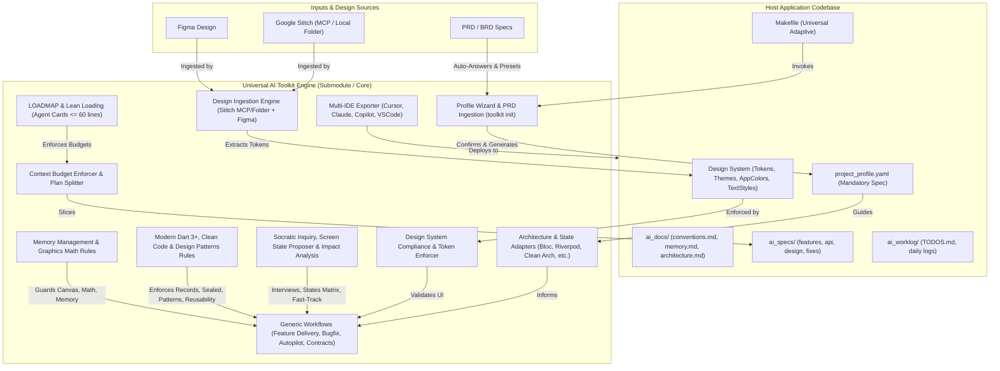
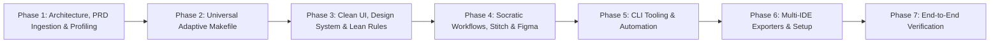

# Universal AI Toolkit v2 (Codebase-Agnostic Engine)
## Master Implementation Plan & Architecture Roadmap

---

## 1. Executive Summary & Vision

**Universal AI Toolkit (v2)** is a modular, codebase-agnostic, multi-IDE software engineering accelerator for AI coding agents. 

While v1 coupled agent workflows to specific codebase naming conventions, class implementations (`DioHelper`, `AppButton`), specific state management (`Cubit`), and hardcoded directory layouts, **v2 separates the Execution Engine from Project Conventions**.

### Core Tenets:
1. **Zero Codebase Assumptions:** Works seamlessly with Single-App, Multi-Flavor, and Multi-Packaging / Monorepo setups.
2. **Mandatory Project Profiling (`project_profile.yaml`):** 
   - Gatekeeper onboarding wizard that locks project identity before any feature or code work begins.
   - **PRD/BRD Auto-Inference:** Ingests PRD/BRD or existing code to auto-answer 80%+ of profile questions.
   - **Standard Presets:** Quick selection for recurring stacks (e.g. `Clean Arch + BLoC`, `Modular + Riverpod`).
   - **User Confirmation:** Agent always presents the drafted profile for final developer approval with *Skip*, *I Don't Know*, and *AI Best Choice* options.
3. **Design System Extraction & Strict Enforcement:**
   - Systematic extraction of Design System tokens from design inputs: Colors (Palette, Brand, Semantic), Typography Scale, Spacing/Padding, Elevation/Shadows, Border Radii, and Component Themes.
   - **Strict Code Compliance:** Absolute zero-tolerance for hardcoded color hexes (`Color(0xFF...)`), arbitrary font sizes (`fontSize: 16`), or ad-hoc padding literals in screen widgets. All UI must consume established design tokens.
4. **Multi-Source Design Ingestion (Google Stitch & Figma via MCP or Local Folder):**
   - Full support for **Google Stitch** designs: ingested either directly via **Stitch MCP Server/Tools** or from a local folder containing exported Stitch screens, JSON layouts, and assets.
   - Unified design pipeline that translates Stitch / Figma frames, components, and token trees into Flutter code specs and theme definitions.
5. **Universal Clean Code & Applied Design Patterns:**
   - **Clean Code as Non-Negotiable Baseline:** Regardless of project size or architecture (MVP or enterprise), always adhere to Dart & Flutter clean code best practices (SRP, DRY, Composition over Inheritance, immutability, `const` constructors).
   - **Reusability by Default:** High emphasis on widget decomposition and logic reusability; zero near-duplicate code.
   - **Targeted Design Patterns:** Apply appropriate patterns naturally where they fit (Factory, Strategy, Observer, Builder, Adapter) in both UI and logic without over-engineering.
6. **Modern Dart 3+ in Presentation/UI:**
   - Strict standards for the presentation layer: when to use **Records** (lightweight tuples), **Sealed Classes** (exhaustive pattern matching), and **Class Modifiers** (`interface`, `base`, `abstract`).
   - **Intentionality & Transparency:** Agent must justify *why* a construct is used, verify if it's the optimal solution, and explicitly label any temporary trade-off or workaround (`// TODO: temporary trade-off - reason: ...`).
7. **Collaborative Thinking, Socratic Inquiry & Impact Analysis (with Fast-Track Skip):**
   - Agent thinks *with* the developer before writing code; asks probing questions to uncover edge cases and failure scenarios.
   - **Fast-Track Option (`Skip`):** For simple, obvious fixes or small UI tweaks, allow immediate execution without unnecessary questioning.
   - **Impact Analysis (Blast Radius):** Nothing is executed without clarifying: *Why is this done? What else is affected? Is this the most suitable solution?*
   - **Simplicity First:** Always choose the simplest, cleanest, most suitable solution before adding complexity.
8. **Screen States Matrix & Proactive Scenario Proposer:**
   - Every screen specification explicitly defines its state suite: **Loading**, **Error**, **Loaded/Success**, **Empty**, **Refreshing**.
   - Proactive questionnaire: *Does this screen need all states or a subset? Does it require Dialogs, Bottom Sheets, Toasts, or Shimmer skeletons?*
   - Proactive Scenario Suggestions: Agent actively checks and proposes missing requirements (e.g., **Offline-first caching**, empty state action buttons, partial failure recovery, retry mechanisms, network drop handling).
9. **High-Performance UI, Memory Management & Graphics:**
   - Full explanation of every mathematical formula, `CustomPaint`, Canvas drawing, and Animation.
   - Zero-leak lifecycle: strict disposal of `AnimationController`, tickers, streams, and controllers.
   - Rendering optimization (`RepaintBoundary`, caching `Path`/`Paint`, avoiding rebuilding identical widgets).
10. **Lean Loading & Context Budget Protection:** Strict 60-line Agent Cards, tag-based loading, and automatic plan splitting (`plan.md` < 8KB, finished phases moved to `history.md`).
11. **Universal Adaptive Makefile:** Single Makefile supporting any flavor configuration, packaging archetype, and configurable remote submodule.
12. **Multi-IDE & Agent Portability:** Out-of-the-box support for Cursor (`.cursor/`), Claude Code / Antigravity (`CLAUDE.md`, `AGENTS.md`), Windsurf, and VS Code.

---

## 2. Architectural Blueprint

---

## 3. Phased Implementation Roadmap

---

### Phase 1: Foundation, PRD Ingestion & Mandatory Project Profiling Engine
> **Goal:** Create the project profiling schema, PRD/BRD auto-parser, quick presets, mandatory preflight gatekeeper, and interactive wizard with AI decision support.

- [x] **Task 1.1: Design `project_profile.yaml` Schema**
  - Define full schema specification:
    - `project_type`: `single_app` | `multi_flavor` | `multi_package` | `monorepo`
    - `architecture`: `feature_first_clean` | `layer_first` | `modular` | `custom`
    - `state_management`: `bloc_cubit` | `riverpod` | `provider` | `mobx` | `signals`
    - `network_client`: `dio` | `retrofit` | `http` | `graphql`
    - `dependency_injection`: `injectable_get_it` | `riverpod` | `none_manual`
    - `navigation`: `go_router` | `auto_route` | `navigator_2`
    - `localization`: `arb_gen_l10n` | `easy_localization_json` | `slang` | `none`
    - `directionality`: `rtl_first` | `ltr_first` | `bi_directional`
    - `design_system`:
      - `tokens_path`: path to design tokens directory
      - `design_source`: `google_stitch_mcp` | `google_stitch_folder` | `figma` | `manual`
    - `testing_gate`: `strict` (mandatory per phase) | `recommended` | `mvp_disabled`
    - `custom_tokens`: Paths to shared widgets (`button`, `image`, `back_button`, `svg`)
- [x] **Task 1.2: Build PRD/BRD Ingestion & Preset Engine**
  - Ability to scan existing `PRD.md`, `BRD.md`, or project dependencies to auto-populate the profile.
  - Built-in recurring presets:
    - `preset: enterprise_clean_bloc` (Clean Arch + BLoC + Dio + GetIt + ARB)
    - `preset: modern_modular_riverpod` (Feature First + Riverpod + Retrofit + GoRouter)
    - `preset: lean_mvp` (Provider / Signals + HTTP + Easy Localization)
  - Interactive Confirmation: Agent presents the draft profile to the developer ("Does this look right or do you want to adjust anything?") before saving.
- [x] **Task 1.3: Build Interactive Onboarding Wizard (`toolkit init`)**
  - Step-by-step interactive questions with the 3 smart options for every question:
    - `[Skip]`: Fall back to safe industry-standard defaults.
    - `[I Don't Know]`: Explain trade-offs in clear, plain language with pros/cons.
    - `[Choose the Best (AI Recommendation)]`: Agent inspects existing project context or performs real-time research, explaining the reasoning before applying.
- [x] **Task 1.4: Mandatory Preflight Gatekeeper Integration**
  - Create preflight validation logic: If `project_profile.yaml` is absent or incomplete, immediately halt any feature implementation and invoke the Profile Wizard.
- [x] **Task 1.5: Dynamic App Conventions Bridge**
  - Implement template generator for `ai_docs/conventions.md`, `ai_docs/architecture.md`, and `ai_docs/memory.md` seeded directly from the validated `project_profile.yaml`.

*Deliverables:* `schema/project_profile.schema.json`, `bin/wizard/init_profile.py`, `presets/*.yaml`, `templates/app-seed/project_profile.template.yaml`.

---

### Phase 2: Universal Adaptive Makefile
> **Goal:** Build a robust, dynamic Makefile capable of handling single-app, multi-flavor, and multi-packaging architectures with configurable Git remotes.

- [x] **Task 2.1: Dynamic Flavor & Package Detection Engine**
  - Auto-detect flavors from `project_profile.yaml` or allow override via `FLAVORS ?= ...`.
  - Handle single-app mode (no flavor required; `make run`, `make build` work directly without flavor prompts).
  - Handle multi-flavor & multi-packaging modes (`make <flavor> run`, `make <flavor>-apk`, etc.).
- [x] **Task 2.2: Configurable Remote Submodule Targets**
  - Parametrize `TOOLKIT_REPO ?= https://github.com/HOSSAM-ORGANIZATION/ai_toolkit_v2.git`.
  - Provide targets: `toolkit-add`, `toolkit-sync`, `toolkit-pull`, `toolkit-push`, `toolkit-status`.
- [x] **Task 2.3: Core Lifecycle Helpers**
  - `make get`: Run package resolution (`flutter pub get` or monorepo workspace equivalent).
  - `make codegen`: Dynamic build_runner invocation (respects package boundaries).
  - `make clean`: Deep clean (Flutter, Pods, build caches).
  - `make analyze`: Dynamic linter check.
  - `make format`: Formatter across code directories.
  - `make test`: Executes test suite based on `testing_gate` rules.
- [x] **Task 2.4: Asset, Icon, and Splash Storyboard Automation**
  - Generalized icon generation hooks (`icons-<flavor>` or generic `icons`).
  - Generalized splash generation hooks (`splash-<flavor>` or generic `splash`).
  - iOS asset renaming and storyboard synchronization helpers.

*Deliverables:* `templates/root/Makefile.universal`, `docs/tooling/makefile-guide.md`.

---

### Phase 3: Clean Code, Design System Enforcement, Performance & Lean Rules
> **Goal:** Establish strict standards for Clean Code, Design System token enforcement, Reusability, Design Patterns, Dart 3+, zero-leak memory management, and 60-line Lean Loading cards.

- [x] **Task 3.1: Design System Enforcement & Token Compliance Rule (`rules/flutter/design-system-enforcement.md`)**
  - **Zero Hardcoding Mandate:** Absolute ban on literal hex colors (`Color(0xFF...)`), hardcoded text sizes (`fontSize: 14`), or magic padding numbers (`EdgeInsets.all(12)`) in screen/widget code.
  - **Token Consumption Matrix:**
    - Colors -> must consume `AppColors` or `Theme.of(context).colorScheme`.
    - Typography -> must consume `AppTypography`, `TextStyles`, or `Theme.of(context).textTheme`.
    - Spacing -> must consume `Dimensions` or `AppSpacing`.
    - Radius & Shapes -> must consume `AppRadii` or theme shapes.
  - Enforce shared UI wrappers (`AppButton`, `AppImage`, `AppTextField`) mapped in `ai_docs/conventions.md`.
- [x] **Task 3.2: Clean Code, Reusability & Applied Design Patterns Rule (`rules/dart/clean-code-and-patterns.md`)**
  - **Universal Baseline:** Regardless of architecture or project size, strictly follow Dart/Flutter Clean Code (Single Responsibility Principle, DRY, composition over inheritance, immutability, `const` constructors).
  - **Widget & Logic Reusability:** Guidelines for decomposing large widgets into reusable domain components; preventing near-duplicate widgets.
  - **Applied Design Patterns:** Clear rules for using patterns where appropriate (Factory, Strategy, Observer, Builder, Adapter).
- [x] **Task 3.3: Modern Dart 3+ Clean Presentation Rules (`rules/dart/presentation-clean-code.md`)**
  - Explicit guidelines on when to use **Records**, **Sealed Classes**, and **Class Modifiers**.
  - **Intentionality Standard:** Agent must document *why* every major architectural construct is chosen, whether it represents the optimal path or a pragmatic temporary trade-off.
- [x] **Task 3.4: High-Performance UI, Memory Management & Graphics Rule (`rules/flutter/ui-performance-and-graphics.md`)**
  - **Mathematical Transparency:** When writing `CustomPainter`, Canvas drawing, complex layouts, or calculations, the agent must explain every formula, point, and dimension step-by-step.
  - **Memory Leak Protection:** Enforce mandatory disposal of `AnimationController`, `TickerProvider`, `ScrollController`, `TextEditingController`, and streams.
  - **Repaint Optimization:** Mandatory use of `RepaintBoundary`, caching `Paint`/`Path`, and avoiding rebuilds with `const`.
- [x] **Task 3.5: Universal LOADMAP & Tag Taxonomy (`LOADMAP.md`)**
  - Define generic tags: `ui`, `data`, `domain`, `state`, `di`, `nav`, `l10n`, `design-system`, `stitch`, `figma`, `patterns`, `pagination`, `observer`, `theme`, `perf`, `math`, `codegen`, `flavors`, `app-memory`.
  - Map each tag to modular leaf rules.
- [x] **Task 3.6: Strict Context Budget Enforcer & Plan Auto-Splitter**
  - Automated rotation: When a phase is marked `[x] DONE`, archive it to `history.md` so `plan.md` stays lightweight (< 8KB).

*Deliverables:* `LOADMAP.md`, `rules/` directory with 60-line Agent Cards, `rules/flutter/design-system-enforcement.md`, `rules/dart/clean-code-and-patterns.md`, `rules/dart/presentation-clean-code.md`, `rules/flutter/ui-performance-and-graphics.md`.

---

### Phase 4: Socratic Workflows, Google Stitch & Figma Analysis, Screen States
> **Goal:** Embed collaborative thinking, Google Stitch (MCP & Folder) + Figma design analysis, Design System extraction, and Screen States Matrix into workflows.

- [x] **Task 4.1: Unified Design Ingestion & Design System Extractor (`workflows/product-analysis/design-ingestion.md`)**
  - **Google Stitch Ingestion:**
    - *Mode A (MCP Server):* Query Google Stitch MCP to retrieve screen layouts, structured JSON components, and design tokens directly.
    - *Mode B (Local Folder):* Parse local folder containing exported Stitch screens, JSON layout definitions, and design assets.
  - **Figma Ingestion:** Existing Figma MCP / export integration with adaptive RTL/LTR directionality.
  - **Design System Extraction & Scaffolding:**
    - Parse raw design tokens into `ai_specs/design/DESIGN_SYSTEM.md`.
    - Auto-scaffold Flutter Design System files: `app_colors.dart`, `app_text_styles.dart`, `app_dimensions.dart`, `app_theme.dart`.
- [x] **Task 4.2: Collaborative Socratic Problem Solving & Impact Analysis Protocol (`workflows/maintenance/collaborative-problem-solving.md`)**
  - Before writing code for bugs or new features:
    - **Fast-Track Option (`[Skip / Quick-Fix]`):** For minor UI tweaks or well-defined single-file fixes, skip the interview and implement immediately.
    - **Probing Questions:** For substantial features/fixes, ask the developer targeted questions to explore edge cases and user journeys.
    - **Impact Analysis (Blast Radius):** Document what other modules or screens might be affected.
    - **Simplicity-First Gate:** Always evaluate solutions starting from the simplest and cleanest.
- [x] **Task 4.3: Screen States Matrix & Proactive Scenario Proposer (`workflows/feature-delivery/screen-states-protocol.md`)**
  - **Screen States Questionnaire:** Confirm required states: *Loading*, *Error*, *Loaded/Success*, *Empty*, *Refreshing*, *Overlays (Dialog, Bottom Sheet, Toast, Shimmer)*.
  - **Proactive Missing Scenario Engine:** Propose real-world requirements: *Offline-first caching, network retry actions, empty call-to-actions, session timeouts*.
- [x] **Task 4.4: Feature Delivery Workflows**
  - `workflows/session/bootstrap-session.md`: Ordered session bootstrap with mandatory profile check.
  - `workflows/feature-delivery/make-plan.md`: Spec breakdown into phased, checkable plans with input/output contracts and screen state checklists.
  - `workflows/feature-delivery/implement-phase.md`: Single-phase execution using tag-targeted lean loading.
  - `workflows/feature-delivery/verify-and-pr.md`: Verification gate (analyzer, tests, git diff sanity check).
- [x] **Task 4.5: Backend Contract Kit (Agnostic Edition)**
  - `workflows/api-analysis/backend-contract.md`: Standardized protocol for reporting gaps to backend teams (`request`, `check`, `apply`, `intake`).
  - Contract templates: `backend-request.md`, `backend-reply.md`, `backend-gaps.md`, `contracts-index.md`.
- [x] **Task 4.6: Autopilot Workflow & Execution Modes**
  - `workflows/feature-delivery/autopilot-phases.md`: Automated consecutive execution of unfinished phases (`Direct`, `Safe`, `Cloud`).
- [x] **Task 4.7: Maintenance & Worklog Kit**
  - Bugfix intake & regression test workflow.
  - Refactoring workflow.
  - Daily worklog & TODOs updater (`workflows/worklog/`).

*Deliverables:* `workflows/product-analysis/design-ingestion.md`, `templates/design/design-system.md`, `workflows/feature-delivery/screen-states-protocol.md`.

---

### Phase 5: CLI Tooling & Automation (`bin/`)
> **Goal:** Ship cross-platform CLI utilities for toolkit maintenance, profile generation, and developer productivity.

- [x] **Task 5.1: Core `bin/toolkit` CLI**
  - Subcommands:
    - `toolkit init [--prd path] [--preset name]`: Run interactive profile wizard or PRD-assisted onboarding.
    - `toolkit design-import [--stitch-mcp | --stitch-dir path | --figma]`: Run Design System extraction.
    - `toolkit context <feature> [phase]`: Measure resolved token budget for planned phases.
    - `toolkit plan-split <feature>`: Automatically move completed phases to `history.md`.
    - `toolkit sync` / `pull` / `push` / `status`: Submodule management.
    - `toolkit audit`: Check compliance of `plan.md` sizes and broken cross-references.
- [x] **Task 5.2: Universal `bin/l10n-sync`**
  - Support adding keys to ARB files, JSON files, or Slang assets across all supported locales.
  - Auto-run translation generator.
- [x] **Task 5.3: `bin/verify-setup` Integrity Checker**
  - Strict validator for links, missing templates, un-migrated paths, and context budgets.

*Deliverables:* `bin/toolkit`, `bin/l10n-sync`, `bin/verify-setup`.

---

### Phase 6: Multi-IDE Exporters & Installation System
> **Goal:** One-click deployment of rules and skills across Cursor, Claude Code, Antigravity, Windsurf, and VS Code.

- [x] **Task 6.1: Cursor Skills & Rules Exporter**
  - Templates for Cursor skills: `autopilot-plan`, `feature-make-plan`, `feature-implement-phase`, `feature-verify-pr`, `bugfix`, `backend-contract`, `design-import`.
  - Compiler from generic rules to `.cursor/rules/*.mdc`.
- [x] **Task 6.2: Universal Agent & Terminal Exporter**
  - Generate `CLAUDE.md` and `AGENTS.md` for CLI agents.
- [x] **Task 6.3: Search Exclusions & Ignore Rules**
  - Generate `.cursorignore` and `.cursorindexingignore` (skipping generated files, heavy PDFs, raw payloads).
  - Generate `.vscode/settings.json` search exclusions (excluding `ai_specs`, `ai_docs`, `ai_worklog` from polluting general symbol searches).
- [x] **Task 6.4: One-Click Installer (`setup/install.sh`)**
  - Unified shell script that installs skills, rules, ignores, and search settings into the host repository cleanly.

*Deliverables:* `setup/install.sh`, `setup/install-rules.sh`, `setup/install-skills.sh`, `templates/cursor-rules/`, `templates/cursor-skills/`.

---

### Phase 7: End-to-End Verification & Documentation
> **Goal:** Validate the toolkit against multiple real-world archetypes and document usage.

- [x] **Task 7.1: Archetype Verification Testing**
  - Test Case A: Fresh single-app Flutter project (Riverpod + GoRouter + JSON l10n).
  - Test Case B: Multi-flavor enterprise project (Bloc + Clean Architecture + ARB l10n).
  - Test Case C: Stitch Design Ingestion & Design System Token verification (Zero-hardcoding test).
- [x] **Task 7.2: Comprehensive Documentation**
  - `README.md`: Toolkit overview, philosophy, and installation instructions.
  - `INDEX.md`: Agent entrypoint and task routing table.
  - `docs/`: In-depth guides for architecture, workflows, clean UI standards, design system enforcement, and performance.
- [x] **Task 7.3: Git Repository Initialization & Release Tagging**
  - Initialize clean Git repository at `ai_toolkit_v2`.
  - Setup `.gitignore`, commit all initial modules, and tag release `v2.0.0-universal`.

---

### Phase 8: On-Demand Blueprint Catalog & Scaffolding Engine
> **Goal:** Decoupled, production-grade Flutter building blocks borrowed from battle-tested projects, re-implemented with modern Dart 3+ and clean architecture.

- [x] **Task 8.1: UI Blueprint Catalog (`templates/blueprints/ui/`)**
  - `app_button`: Primary, Secondary, Outlined, Danger, Text with loading spinner.
  - `app_text_field`: Universal text field with obscure toggle and error handling.
  - `app_image`: Multi-source image renderer (network/asset/svg/file) with error fallbacks.
  - `app_back_button`: Adaptive RTL/LTR back navigation button.
  - `app_dropdown`: Searchable bottom-sheet dropdown selection widget.
  - `app_phone_field`: Phone number field with country code picker and validation.
  - `currency_price_text`: Price text widget with discount strike-through.
  - `app_fail_widget` & `app_empty_widget`: Clean state handling widgets.
  - `shimmer_skeleton`: Zero-dependency shimmer loader.
  - `payment_webview_page`: Payment gateway webview with URL interceptors.
- [x] **Task 8.2: Pattern & Architecture Blueprints (`templates/blueprints/patterns/`)**
  - `observer_hub`: Decoupled event bus / observer hub.
  - `paginated_list_view`: Infinite scroll list with pull-to-refresh and retry.
  - `async_state`: Dart 3 Sealed Classes `AsyncState<T>` with exhaustive pattern matching.
  - `guest_guard`: Action interceptor and login bottom sheet for guests.
  - `use_case`: Clean Architecture UseCase contract with sealed `Result<T>`.
  - `stepped_wizard`: Multi-step flow controller with indicator and validation.
- [x] **Task 8.3: Utility Blueprints (`templates/blueprints/utils/`)**
  - `context_extensions`: Concise BuildContext shortcuts (theme, dimensions, keyboard, SnackBars).
  - `form_validator`: Fluent chainable form validator (`required().email().minLength(8)`).
- [x] **Task 8.4: Scaffolding CLI (`bin/scaffolder/add_blueprint.py` & `toolkit add`)**
  - Interactive/CLI dispatcher copying templates, adjusting class names, and registering in `ai_docs/conventions.md`.
  - Catalog reference documentation in `templates/blueprints/CATALOG.md`.

---

## 4. Immediate Execution Plan

All 8 phases have been successfully authored, integrated, tested, and verified!
