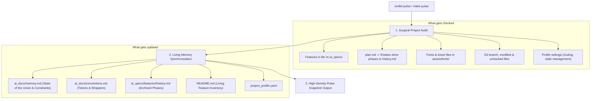

# Project Pulse & Living Memory Synchronization

> **Aliases:** `project-pulse`, `pulse`, `sync-state`, `sync-memory`  
> **Purpose:** Keeps the living memory, feature history, and documentation of the project 100% synchronized with the actual codebase state. Captures "every breath" of the project with zero context drift.  
> **Cost:** 0 Token cost execution via the automated pulse engine (`bin/sync/project_pulse.py`).

---

## 1. When to Run

Execute this workflow whenever any of the following triggers occur:
1. **End of a Working Session:** Before concluding an agent conversation or handoff.
2. **Phase Completion:** Immediately after completing a phase in [`workflows/feature-delivery/implement-phase.md`](../feature-delivery/implement-phase.md) to rotate completed items into `history.md`.
3. **Design / Font Ingestion:** After changing tokens, fonts, or themes via [`workflows/product-analysis/design-ingestion.md`](../product-analysis/design-ingestion.md).
4. **Pre-PR / Pre-Commit:** Before running [`workflows/feature-delivery/verify-and-pr.md`](../feature-delivery/verify-and-pr.md).
5. **Session Resume:** At session start if `git status` indicates unrecorded external modifications.

---

## 2. Core Execution Protocol

Run the pulse engine via CLI or Makefile:

```bash
# Via Toolkit CLI
toolkit pulse

# Or via Makefile
make pulse
```

*(Direct script execution: `python3 ai_toolkit/bin/sync/project_pulse.py`)*

---

## 3. What the Pulse Engine Audits & Synchronizes



---

## 4. Key Artifacts Synchronized

### 1. `ai_specs/features/<feature>/history.md`
- Whenever a phase is marked `[x] DONE` in `plan.md`, the engine automatically cuts it from `plan.md` and appends it to `history.md`.
- **Why:** Keeps `plan.md` lean (< 8KB) and prevents AI context window degradation, while preserving a permanent historical audit trail of all finished work.

### 2. `ai_docs/memory.md`
- Updates the **Feature Execution & History Status** table:
  - Tracks whether code exists, plan is active, and history is archived.
- Updates the **Quick Technical Constraints** table with the timestamp, branch name, and primary font.

### 3. `ai_docs/conventions.md` & `project_profile.yaml`
- Reflects active font families, token locations, and shared design system wrappers.

### 4. `README.md` (Living Readme)
- Updates the feature status table and active surface breakdown.

---

## 5. AI Decision Cases

| Situation | Agent Action |
| :--- | :--- |
| **Feature code exists in `lib/features/` without an `ai_specs/` plan** | Mark status `Implemented (No Plan)` in memory.md; suggest generating spec if untested. |
| **`plan.md` exceeds 8KB** | Pulse automatically splits and rotates completed phases to `history.md`. |
| **New custom font added to `assets/fonts/`** | Pulse records it in `memory.md` and verifies `pubspec.yaml` registration. |
| **Git working directory has uncommitted files** | Pulse includes uncommitted modified/untracked counts in the state snapshot. |
| **New feature completed (`remaining == 0`)** | Mark feature as `Completed` in memory.md and living readme. |

---

## 6. Handoff

After running `toolkit pulse`:
- The AI agent has an exact, fresh 15-line **State of the Union** snapshot.
- Proceed to:
  - Next implementation phase via [`workflows/feature-delivery/implement-phase.md`](../feature-delivery/implement-phase.md).
  - Autonomous QA via [`workflows/qa-verification/autonomous-qa-loop.md`](../qa-verification/autonomous-qa-loop.md).
  - PR preparation via [`workflows/feature-delivery/verify-and-pr.md`](../feature-delivery/verify-and-pr.md).
