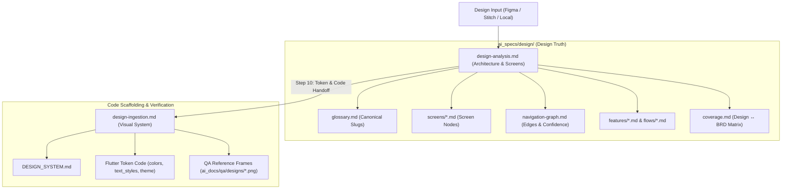

# Unified Design Analysis & Architecture Workflow

> **Aliases:** `design-analysis`, `figma-analysis`, `stitch-analysis`  
> **Master Workflow:** Creates the app-specific design knowledge base, screen inventory, and navigation truth from **Figma**, **Google Stitch**, or **Local Design Exports**.  
> **Synergy:** Seamlessly orchestrates and hands off to [`design-ingestion.md`](design-ingestion.md) for design token extraction, Flutter theme code scaffolding, and QA visual baseline assets.

---

## 1. Purpose & Architecture

The Design Analysis workflow establishes the **UI, Screen, and Navigation Truth** for the application:
- Creates a structured, AI-readable specification under `ai_specs/design/`.
- Sits beside the Business Requirements Document (`ai_specs/brd/`) and feeds feature implementation plans (`workflows/feature-delivery/make-plan.md`).
- Maps out every navigable node (screen, modal, bottom sheet, tab-shell) and every navigation edge with strict confidence ratings.
- Triggers the visual token pipeline in [`design-ingestion.md`](design-ingestion.md) to generate Flutter code without code-duplication.



---

## 2. Input Sources & Modes

### Source A: Google Stitch
- **Mode 1 (Stitch MCP):** Use Stitch MCP tools (`get_project`, `list_screens`, `get_screen`, `download_file`) to inspect live screen structures, layout trees, and component definitions.
- **Mode 2 (Local Folder):** Inspect a local folder (e.g. `design_export/stitch/` or `ai_specs/design/source/stitch/`) containing exported Stitch JSON definitions, HTML/JSON layout specs, and screen previews.

### Source B: Figma
- **Mode 1 (Figma MCP):** Query Figma MCP tools (`get_figma_data`, `download_figma_images`) using File Key and Node IDs.
- **Mode 2 (Local Folder):** Inspect a local folder (e.g. `design_export/figma/` or `ai_specs/design/source/figma/`) containing exported screenshots (`*.png`, `*.svg`) and exported tokens (`tokens.json` from Tokens Studio or Figma REST API dumps).

> [!NOTE] Handling `.fig` Files
> Raw `.fig` files are proprietary binary containers (compressed KiWi/protobuf schemas). If provided with a `.fig` file:
> 1. **Recommended:** Import the `.fig` file into your Figma account to obtain a web URL and file key for direct Figma MCP inspection.
> 2. **Offline Alternative:** Unzip or export frames as images (`*.png`) and design specs as JSON into a local folder (`design_export/figma/`).

---

## 3. Output Structure

Generates or updates the following hierarchy in the app repository:

```text
ai_specs/design/
  README.md
  INDEX.md
  source/
    design-sources.md          # Pointers to Figma URLs, Stitch project IDs, or local paths
  analysis/
    glossary.md               # Raw messy names → canonical English slugs
    navigation-graph.md       # Full graph of all screens, triggers, and edge confidence
    coverage.md               # Screen ↔ Feature ↔ BRD ↔ Implementation matrix
    design-hygiene.md         # Backlog of messy/unwired frames
    icons-catalog.md          # Optional; normalized icons inventory
    images-catalog.md         # Optional; normalized images inventory
  features/                   # Feature-level design specs (auth.md, checkout.md, etc.)
  flows/                      # Cross-screen user journeys (onboarding_flow.md, etc.)
  screens/                    # Leaf screen nodes (login_screen.md, profile_screen.md)
  app_surfaces/               # Per-actor design specs (customer.md, provider.md, admin.md)
  DESIGN_SYSTEM.md            # Generated via handoff to design-ingestion.md
```

---

## 4. Invocation Modes

### Mode A — Full Project Analysis
Use when bootstrapping a new project or major redesign. Executes all 14 steps below.  
*Examples:* `analyze design for customer app`, `figma-analysis https://www.figma.com/design/...`, `stitch-analysis project_123`.

### Mode B — Refresh Feature
Use when one feature area changed. Re-inventories only frames/screens belonging to that feature, updating its glossary rows, screen nodes, flow edges, and coverage without touching unrelated features.  
*Example:* `design-analysis refresh feature authentication`.

### Mode C — Refresh Screen / Page
Use when a single Figma page or Stitch screen changed. Merges updates into glossary, screens, graph, and coverage.  
*Example:* `design-analysis refresh screen checkout_summary`.

### Mode D — Align with BRD
Use when `ai_specs/brd/` exists. Fills the coverage matrix between BRD requirements and design reality, highlighting missing screens and discrepancies. Does not rewrite BRD.

---

## 5. Step-by-Step Execution Protocol

### Step 1: Prepare & Record Sources
Record project IDs, file URLs, file keys, pages in scope, MVP vs archive pages, and last sync date in `ai_specs/design/source/design-sources.md` (using [`templates/design/design-sources.md`](../../templates/design/design-sources.md)).

### Step 2: Inventory Screens & Frames
- **Via Stitch:** List all defined screens and reusable components via `list_screens` or local JSON definitions.
- **Via Figma:** Walk frames via Figma MCP or inspect local exported screenshots. Capture every top-level frame and modal/sheet. Do not invent screens not present in the source.

### Step 3: Classify Every Unit
Classify each item into one of:
`screen` | `modal` | `sheet` | `tab-shell` | `component` | `variant` | `archive` | `junk`
- Only `screen`, `modal`, `sheet`, and `tab-shell` become navigable nodes in the navigation graph.
- Attach variants to their parent screen. Keep archive/junk out of the graph (record once in `coverage.md`).
*(Note: Stitch screens are typically pre-classified, whereas Figma requires filtering messy scratchpad frames).*

### Step 4: Build Canonical Glossary First
Create or update `ai_specs/design/analysis/glossary.md` **before** writing screen specs:
- Map noisy or localized design names (`Frame 102`, `Login V2 AR`) to stable, lowercase English canonical slugs (`auth_login`, `order_details`).
- Record naming quality (`good` | `noisy` | `duplicate` | `unknown`).
- **Freeze these slugs:** All future specs, routes, and Flutter code must reference these canonical slugs.

### Step 5: Write Screen Nodes
For each navigable node, create `ai_specs/design/screens/<slug>.md` using [`templates/design/screen-node.md`](../../templates/design/screen-node.md):
- Fill purpose, source reference (Figma node-id or Stitch screen ID), directionality (`RTL` / `LTR` / `mixed`), entry/exit triggers, states (default, loading, empty, error), primary actions, and open `TBD`s.
- Keep contracts lean; avoid dumping massive raw JSON or widget trees.

### Step 6: Build the Navigation Graph
Create `ai_specs/design/analysis/navigation-graph.md`:
- Map every node and directed transition edge.
- Set **confidence rating** for each edge:
  - `prototype`: Explicitly wired in prototype links.
  - `inferred`: Logically deduced from visible CTAs, tabs, or back buttons.
  - `assumed`: Unclear or guessed destination.
  - `broken`: CTA with missing target or broken wire.
- **Route Gate:** Mark broken targets and orphan nodes. *Never implement code for `assumed` or `broken` edges without user approval.*

### Step 7: Cluster by Feature
Group nodes by domain (auth, catalog, cart, profile) and write `ai_specs/design/features/<feature>.md` using [`templates/design/feature-design-spec.md`](../../templates/design/feature-design-spec.md).

### Step 8: Write User Flow Specs
Document multi-screen user journeys in `ai_specs/design/flows/<flow>.md` using [`templates/design/flow-spec.md`](../../templates/design/flow-spec.md) (e.g., checkout flow, registration flow).

### Step 9: Write App-Surface Specs
When the app has multiple actors (customer, vendor, rider, admin), document each surface in `ai_specs/design/app_surfaces/<surface>.md`.

### Step 10: Token Extraction & Code Scaffolding Handoff
> **Mandatory Integration Gate:**
> Execute [`workflows/product-analysis/design-ingestion.md`](design-ingestion.md) to complete the visual pipeline:
1. Extract design tokens (colors, typography, spacing, radii, elevation).
2. Generate `ai_specs/design/DESIGN_SYSTEM.md`.
3. Scaffold or update Flutter token code (`colors.dart`, `text_styles.dart`, `dimensions.dart`, `app_theme.dart`).
4. Save exported frame screenshots to `ai_docs/qa/designs/<feature>.png` for the [Autonomous QA Loop](../qa-verification/autonomous-qa-loop.md).

### Step 11: Coverage & Contradiction Analysis
Create `ai_specs/design/analysis/coverage.md`:
- Map every design screen → feature → route.
- Map BRD business requirements → design screen (or mark `TBD(design)`).
- Document any contradictions between design and BRD without silently picking a winner.

### Step 12: Build Master Design Index
Create `ai_specs/design/INDEX.md` and `README.md` using [`templates/design/design-index.md`](../../templates/design/design-index.md) to provide a clear entrypoint for future coding agents.

### Step 13: Wire Project Indexes
Update root `ai_specs/INDEX.md` and ensure feature README files (`ai_specs/features/<feature>/README.md`) link directly to their corresponding design specs.

### Step 14: Review for Scope Leakage
Ensure design specs remain clean contracts. Strip out accidental business logic essays or raw Flutter widget trees; point to BRD for business rules and to feature plans for implementation code.

---

## 6. AI Decision Cases

| Situation | Required Agent Behavior |
| :--- | :--- |
| **Noisy / generic frame name (`Frame 293`)** | Assign a clean canonical slug (e.g., `cart_checkout`); keep raw name in `glossary.md` with status `noisy`. Do not block. |
| **Missing prototype links in design** | Infer edges from obvious CTAs / bottom bars / back arrows; mark confidence `inferred`. |
| **Button / CTA with no destination** | Create edge with `to: TBD(design)` and confidence `broken`. |
| **Ambiguous destination** | Set confidence `assumed`; do not implement route until user confirms. |
| **Raw `.fig` file provided** | Instruct user to import into Figma or provide local exported images/JSON folder. |
| **Google Stitch source provided** | Query Stitch MCP directly or parse local Stitch JSON export. Skip messy frame classifications. |
| **Conflict between Design and BRD** | Record discrepancy in `coverage.md`; report to user and ask which source wins. |
| **RTL / Arabic language detected** | Mark `direction: RTL` in screen nodes; ensure directional widgets use start/end in specs. |
| **Duplicate frames for same screen** | Pick active MVP frame; mark the other as `variant` or `archive` under the same canonical slug. |

---

## 7. Handoff to Feature Delivery

Once `design-analysis.md` (and its nested `design-ingestion.md` step) is complete:
1. The project has complete **Screen Truth** and **Flutter Theme Tokens**.
2. Run [`workflows/feature-delivery/make-plan.md`](../feature-delivery/make-plan.md) to structure implementation phases.
3. Run [`workflows/feature-delivery/implement-phase.md`](../feature-delivery/implement-phase.md) to write the UI, referencing the canonical slugs and token classes.
4. Run [`workflows/qa-verification/autonomous-qa-loop.md`](../qa-verification/autonomous-qa-loop.md) using the reference images saved in `ai_docs/qa/designs/`.